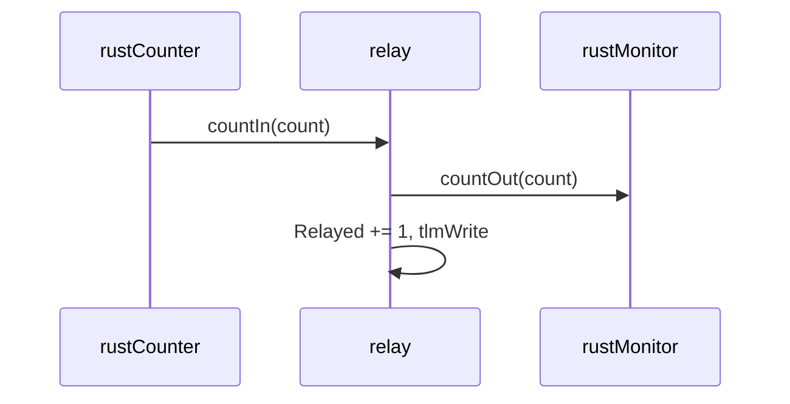

# FprimeRustReference::Relay

## Introduction

`Relay` is a passive C++ component that forwards counts from `RustCounter` to `RustMonitor` and
counts what it relayed. It is the C++ endpoint that proves Rust-to-C++ and C++-to-Rust typed ports.

## Requirements

| ID | Requirement | Verification |
|---|---|---|
| REQ-Relay-001 | Each count received on `countIn` shall be sent unchanged on `countOut` when it is connected. | Unit Test; Integration Test: L2-3, L7-1 |
| REQ-Relay-002 | Each relayed count shall increment and publish `Relayed`. | Unit Test; Integration Test: L2-3, L7-1 |

Telemetry table: `Relayed` (U32, wraps at U32::MAX).

## Design

```
                                        +-------------+
 countIn : FprimeRustReference.Count -->|    Relay    |--> countOut : FprimeRustReference.Count
                                        |  (passive)  |
                                        +-------------+
   special ports: time get, telemetry
```

| Port | Kind | Type | Purpose |
|---|---|---|---|
| countIn | sync input | FprimeRustReference.Count | count from RustCounter |
| countOut | output | FprimeRustReference.Count | count to RustMonitor |

Commands, events, parameters: none. Telemetry: `Relayed` (U32), written on every count.

### Configure

Instance: passive, base id 0x10026000. No constants.

### Behavior

`countIn_handler` forwards the count on `countOut` when `isConnected_countOut_OutputPort()` is true (an
unguarded call on an unconnected output port asserts, plan decision log 11), increments `Relayed` and writes it.
It runs on the caller's thread (rustCounter's); `countOut` is wired to an async port, so the Relay never
blocks on the monitor.



## Tests

<!-- fth:tests:begin -->
_Generated by `fth render-sdd-tests` from the plan — do not edit by hand; the package renderer fails when this table and the plan disagree._

| Test | Purpose | Requirements |
|---|---|---|
| L0-1 | Confirms the running executable reports non-empty project, framework and library version strings for the delivery manifest check. | — |
| L0-2 | Proves the harness tester's MARK command round-trips through the command path (rustTester.Marker) so every later window can be bracketed. | — |
| L2-1 | Resets and bumps the Rust active component to prove async commands dispatch into Rust and events and telemetry come back out. | REQ-FprimeRust-008, REQ-FprimeRust-012, REQ-FprimeRust-013, REQ-FprimeRust-014, REQ-RustCounter-001, REQ-RustCounter-002, REQ-RustCounter-004 |
| L2-2 | Sets THRESHOLD to 5 and bumps past it to prove the Rust handler reads the parameter and saturates on it. | REQ-FprimeRust-015, REQ-RustCounter-003, REQ-RustCounter-006, REQ-RustCounter-007 |
| L2-3 | Bumps the Rust counter and follows the count through the C++ relay into the Rust monitor to prove typed ports in both directions. | REQ-FprimeRust-009, REQ-FprimeRust-010, REQ-FprimeRust-011, REQ-RustCounter-002, REQ-RustCounter-004, REQ-RustMonitor-003, REQ-Relay-001, REQ-Relay-002 |
| L2-4 | Lets the 1 Hz rate group tick the active Rust component and run the queued Rust component to prove C++ scheduler ports into Rust handlers. | REQ-FprimeRust-008, REQ-FprimeRust-009, REQ-FprimeRust-011, REQ-FprimeRust-014, REQ-RustCounter-005, REQ-RustMonitor-005 |
| L2-5 | Sets the monitor limit then bumps past it to prove a queued Rust component handles commands and raises a warning event from a relayed count. | REQ-FprimeRust-008, REQ-FprimeRust-012, REQ-FprimeRust-013, REQ-RustMonitor-001, REQ-RustMonitor-004, REQ-RustMonitor-006, REQ-RustMonitor-003 |
| L4-1 | Runs the deployment for 60 s to prove the Rust components keep servicing rate-group ports with no command errors or counter drift. | REQ-FprimeRust-014, REQ-RustCounter-005, REQ-RustMonitor-005 |
| L5-1 | Drives the counter into THRESHOLD saturation to prove the Rust warning event and the clamp. | REQ-FprimeRust-013, REQ-FprimeRust-015, REQ-RustCounter-003, REQ-RustCounter-006, REQ-RustCounter-007 |
| L6-1 | Sends an invalid limit to prove the Rust handler rejects it with a validation error and changes nothing else. | REQ-FprimeRust-012, REQ-FprimeRust-013, REQ-RustMonitor-002, REQ-RustMonitor-006 |
| L7-1 | Saves THRESHOLD 42 into the parameter file, downlinks the file into the record and resets the counter to leave the deployment in an independently verifiable state. | REQ-FprimeRust-010, REQ-FprimeRust-011, REQ-RustCounter-001, REQ-RustCounter-004, REQ-Relay-001, REQ-Relay-002, REQ-RustMonitor-003 |
<!-- fth:tests:end -->

## Unit-test list

| Test | Description | Requirements |
|---|---|---|
| UT-Relay-1 | one countIn(7) invocation produces one countOut(7) | REQ-Relay-001 |
| UT-Relay-2 | three invocations publish Relayed = 1, 2, 3; with countOut unconnected the count is dropped and Relayed still increments | REQ-Relay-002 |
