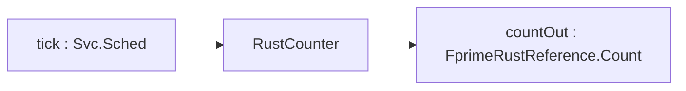

# FprimeRustReference::RustCounter

## Introduction

`RustCounter` is an active component implemented in Rust through `fprime-rust`. It keeps a counter
that commands reset and bump, saturating at a parameter; a rate-group port counts ticks; every change
is reported on an output port to a C++ component. It exists to exercise the Rust integration end to
end in the reference deployment.

## Requirements

| ID | Requirement | Verification |
|---|---|---|
| REQ-RustCounter-001 | RESET shall set the counter to zero and emit `ResetIssued`. | Integration Test: L2-1 |
| REQ-RustCounter-002 | BUMP shall add its amount to the counter and emit `Bumped` with the new value. | Integration Test: L2-1, L2-3 |
| REQ-RustCounter-003 | The counter shall not exceed THRESHOLD; a saturating BUMP shall emit `Saturated`. | Integration Test: L2-2, L5-1 |
| REQ-RustCounter-004 | Every counter change shall be published on `Counter` and sent on `countOut`. | Integration Test: L2-1, L2-3 |
| REQ-RustCounter-005 | Each `tick` shall increment `TickCount` and publish it. | Integration Test: L2-4, L4-1 |
| REQ-RustCounter-006 | THRESHOLD shall be re-read on every BUMP. | Integration Test: L2-2 |

Command table (REQ-RustCounter-001, -002): `RESET`, `BUMP(amount: U32)`. Event table: `ResetIssued`,
`Bumped(value)`, `Saturated(value, threshold)`. Telemetry table: `Counter`, `TickCount`. Parameter
table: `THRESHOLD` (U32, default 100).

## Design


Special ports: time get, command reg/recv/resp, event, text event, telemetry, param get/set.

| Port | Kind | Type | Purpose |
|---|---|---|---|
| tick | async input | Svc.Sched | rate-group tick, counts ticks |
| countOut | output | FprimeRustReference.Count | report counter after change |

| Command | Args | Effect |
|---|---|---|
| RESET | — | counter = 0; `ResetIssued`; `Counter`; `countOut` |
| BUMP | amount: U32 | counter = min(counter + amount, THRESHOLD); `Bumped` or `Saturated`; `Counter`; `countOut` |

| Event | Severity | Args |
|---|---|---|
| ResetIssued | activity low | — |
| Bumped | activity low | value: U32 |
| Saturated | warning low | value: U32, threshold: U32 |

| Telemetry | Type | When |
|---|---|---|
| Counter | U32 | every change |
| TickCount | U32 | every tick |

| Parameter | Type | Default |
|---|---|---|
| THRESHOLD | U32 | 100 |

### Configure

Instance: active, queue `Default.QUEUE_SIZE`, stack `Default.STACK_SIZE`, priority 18; `tick` driven by
rate group 1 (1 Hz). Source files: `RustCounter.fpp`, `RustCounter.rs` only.

### Behavior

The component holds a `u32` counter and a `u32` tick count in its Rust state. BUMP reads THRESHOLD,
adds with saturation, and chooses `Bumped` or `Saturated`; RESET clears. Each change writes `Counter`
and sends the value on `countOut`; each tick increments and writes `TickCount`. Both commands respond
`OK`; there is no rejectable input.

```mermaid
sequenceDiagram
  participant G as cmdDisp
  participant R as rustCounter
  participant L as relay
  G->>R: BUMP(amount)
  R->>R: paramGet THRESHOLD; counter = min(counter+amount, THRESHOLD)
  R->>G: Bumped(value) or Saturated(value, threshold)
  R->>L: countOut(counter)
  R->>G: cmdResponse OK
```

Out-of-scope failure modes:

| Failure | Handling |
|---|---|
| THRESHOLD invalid (no prmDb value) | default 100 used; validity ignored |

## Tests

<!-- fth:tests:begin -->
_Generated by `fth render-sdd-tests` from the plan — do not edit by hand; the package renderer fails when this table and the plan disagree._

| Test | Purpose | Requirements |
|---|---|---|
| L0-1 | Confirms the running executable reports the project, framework and library versions recorded in the delivery manifest. | — |
| L0-2 | Proves the marker command round-trips through the command path so every later window can be bracketed. | — |
| L2-1 | Resets and bumps the Rust active component to prove commands dispatch into Rust and events and telemetry come back out. | REQ-FprimeRust-008, REQ-FprimeRust-012, REQ-FprimeRust-013, REQ-FprimeRust-014, REQ-FprimeRust-029 |
| L2-2 | Sets THRESHOLD to 5 and bumps past it to prove the Rust handler reads the parameter and saturates on it. | REQ-FprimeRust-015, REQ-FprimeRust-029 |
| L2-3 | Bumps the Rust counter and follows the count through the C++ relay into the Rust monitor to prove typed ports in both directions. | REQ-FprimeRust-009, REQ-FprimeRust-010, REQ-FprimeRust-011 |
| L2-4 | Lets the 1 Hz rate group tick the active Rust component and run the queued Rust component to prove C++ scheduler ports into Rust handlers. | REQ-FprimeRust-008, REQ-FprimeRust-009, REQ-FprimeRust-011, REQ-FprimeRust-014 |
| L2-5 | Sets the monitor limit then bumps past it to prove a queued Rust component handles commands and raises a warning event from a relayed count. | REQ-FprimeRust-008, REQ-FprimeRust-012, REQ-FprimeRust-013 |
| L4-1 | Runs the deployment for 60 s to prove the Rust components keep servicing rate-group ports with no command errors or counter drift. | REQ-FprimeRust-014, REQ-FprimeRust-029 |
| L5-1 | Drives the counter into THRESHOLD saturation to prove the Rust warning event and the clamp. | REQ-FprimeRust-013, REQ-FprimeRust-015 |
| L6-1 | Sends an invalid limit to prove the Rust handler rejects it with a validation error and changes nothing else. | REQ-FprimeRust-012, REQ-FprimeRust-013 |
| L7-1 | Resets the counter and reads the installed executable back out of band to leave the deployment in an independently verifiable state. | REQ-FprimeRust-010, REQ-FprimeRust-011, REQ-FprimeRust-029 |
<!-- fth:tests:end -->
