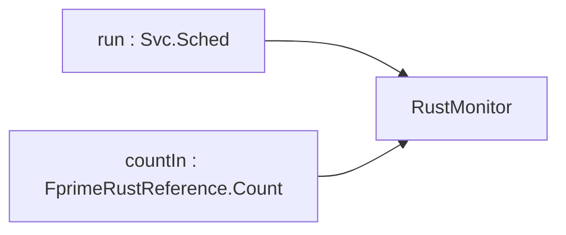

# FprimeRustReference::RustMonitor

## Introduction

`RustMonitor` is a queued component implemented in Rust through `fprime-rust`. It receives counts
relayed by the C++ `Relay` component, compares them with a commanded limit, and publishes telemetry
when run from a rate group. It exercises the queued kind, a sync and an async typed input port, a
rejectable command, and events of two severities.

## Requirements

| ID | Requirement | Verification |
|---|---|---|
| REQ-RustMonitor-001 | SET_LIMIT with a non-zero limit shall store it, emit `LimitSet` and publish `Limit`. | Integration Test: L2-5 |
| REQ-RustMonitor-002 | SET_LIMIT with limit zero shall be rejected with `InvalidLimit` and leave the limit unchanged. | Integration Test: L6-1 |
| REQ-RustMonitor-003 | Each count received shall be published on `LastCount`. | Integration Test: L2-3 |
| REQ-RustMonitor-004 | A count greater than the limit shall emit `LimitExceeded` and increment `Exceedances`. | Integration Test: L2-5 |
| REQ-RustMonitor-005 | Each `run` shall dispatch queued counts, increment `RunCount` and publish it. | Integration Test: L2-4, L4-1 |

Command table: `SET_LIMIT(limit: U32)`. Event table: `LimitSet(limit)`, `InvalidLimit(limit)`,
`LimitExceeded(count, limit)`. Telemetry table: `RunCount`, `LastCount`, `Exceedances`, `Limit`.
Constants: initial limit `U32::MAX`.

## Design


Special ports: time get, command reg/recv/resp, event, text event, telemetry.

| Port | Kind | Type | Purpose |
|---|---|---|---|
| run | sync input | Svc.Sched | dispatch queue, publish RunCount |
| countIn | async input | FprimeRustReference.Count | count from relay |

| Command | Args | Effect |
|---|---|---|
| SET_LIMIT | limit: U32 | limit > 0: store, `LimitSet`, `Limit`, OK; limit = 0: `InvalidLimit`, VALIDATION_ERROR |

| Event | Severity | Args |
|---|---|---|
| LimitSet | activity low | limit: U32 |
| InvalidLimit | warning low | limit: U32 |
| LimitExceeded | warning high | count: U32, limit: U32 |

| Telemetry | Type | When |
|---|---|---|
| RunCount | U32 | every run |
| LastCount | U32 | every count |
| Exceedances | U32 | every exceedance |
| Limit | U32 | every SET_LIMIT accepted |

Parameters: none.

### Configure

Instance: queued, queue `Default.QUEUE_SIZE`; `run` driven by rate group 1 (1 Hz). Source files:
`RustMonitor.fpp`, `RustMonitor.rs` only.

### Behavior

Counts and commands queue until `run` dispatches them on the rate-group thread, so all Rust state is
touched on one thread. A dispatched count is published as `LastCount`; when it exceeds the limit,
`LimitExceeded` is emitted and `Exceedances` incremented. SET_LIMIT validates non-zero before
storing. `run` increments and publishes `RunCount` after dispatch.

```mermaid
sequenceDiagram
  participant RG as rateGroup1
  participant L as relay
  participant M as rustMonitor
  L->>M: countIn(count) (queued)
  RG->>M: run
  M->>M: dispatch countIn: LastCount; if count > limit: LimitExceeded, Exceedances
  M->>M: RunCount += 1
```

Out-of-scope failure modes:

| Failure | Handling |
|---|---|
| queue full | F Prime queued-component overflow behavior (assert) |

## Tests

<!-- fth:tests:begin -->
_Generated by `fth render-sdd-tests` from the plan — do not edit by hand; the package renderer fails when this table and the plan disagree._

| Test | Purpose | Requirements |
|---|---|---|
| L0-1 | Confirms the running executable reports the project, framework and library versions recorded in the delivery manifest. | — |
| L0-2 | Proves the marker command round-trips through the command path so every later window can be bracketed. | — |
| L2-1 | Resets and bumps the Rust active component to prove commands dispatch into Rust and events and telemetry come back out. | REQ-FprimeRust-008, REQ-FprimeRust-012, REQ-FprimeRust-013, REQ-FprimeRust-014, REQ-FprimeRust-029 |
| L2-2 | Sets THRESHOLD to 5 and bumps past it to prove the Rust handler reads the parameter and saturates on it. | REQ-FprimeRust-015, REQ-FprimeRust-029 |
| L2-3 | Bumps the Rust counter and follows the count through the C++ relay into the Rust monitor to prove typed ports in both directions. | REQ-FprimeRust-009, REQ-FprimeRust-010, REQ-FprimeRust-011 |
| L2-4 | Lets the 1 Hz rate group tick the active Rust component and run the queued Rust component to prove C++ scheduler ports into Rust handlers. | REQ-FprimeRust-008, REQ-FprimeRust-009, REQ-FprimeRust-011, REQ-FprimeRust-014 |
| L2-5 | Sets the monitor limit then bumps past it to prove a queued Rust component handles commands and raises a warning event from a relayed count. | REQ-FprimeRust-008, REQ-FprimeRust-012, REQ-FprimeRust-013 |
| L4-1 | Runs the deployment for 60 s to prove the Rust components keep servicing rate-group ports with no command errors or counter drift. | REQ-FprimeRust-014, REQ-FprimeRust-029 |
| L5-1 | Drives the counter into THRESHOLD saturation to prove the Rust warning event and the clamp. | REQ-FprimeRust-013, REQ-FprimeRust-015 |
| L6-1 | Sends an invalid limit to prove the Rust handler rejects it with a validation error and changes nothing else. | REQ-FprimeRust-012, REQ-FprimeRust-013 |
| L7-1 | Resets the counter and reads the installed executable back out of band to leave the deployment in an independently verifiable state. | REQ-FprimeRust-010, REQ-FprimeRust-011, REQ-FprimeRust-029 |
<!-- fth:tests:end -->
